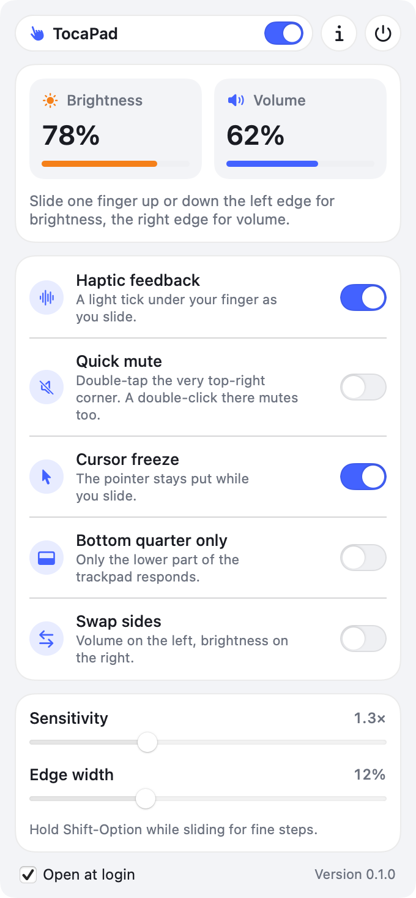
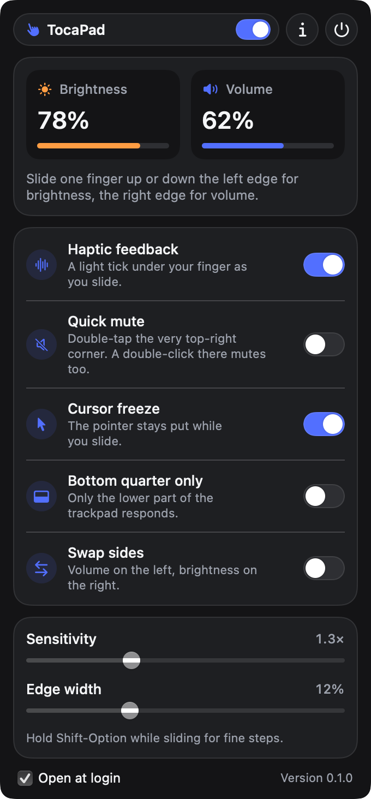

# TocaPad

**Slide the edges of your Mac's trackpad to change volume and brightness. Free and open source.**

No account, no analytics. The only thing TocaPad sends anywhere is a daily check for a new
version on GitHub.

Slide one finger up or down the **right edge** of the trackpad for volume, or the **left
edge** for brightness. A level appears at the top right of the screen as you slide, like
the one the keyboard keys show.

 

## What it does

- **Volume on the right, brightness on the left.** One finger, sliding up or down. A
  second finger cancels, so scrolling and other gestures still work.
- **Haptic feedback:** a light tick under your finger at each step, on Force Touch trackpads.
- **Cursor freeze:** the pointer stays where it was while you slide.
- **Fine steps:** hold Shift-Option while sliding.
- **Quick mute** (off by default): double-tap the very top-right corner of the trackpad.
  With tap to click on, a double-click on something in that corner mutes too, which is why
  it starts off.
- **Bottom quarter only:** only the lower part of the edges responds, if you rest your
  fingers on the trackpad's sides.
- **Swap sides:** volume on the left, brightness on the right.
- **Sensitivity** and **edge width** sliders, and **Open at login**.
- Works with the built-in trackpad and a Magic Trackpad, including one connected after
  TocaPad starts.

## What it can't do

- **Brightness** works on the built-in display and Apple displays. Most other monitors
  don't accept brightness changes from macOS, so the menu shows "Not adjustable".
- **Volume** can't be changed on outputs that set it on the device itself (many HDMI and
  some USB outputs). The menu shows "Not adjustable" there too.
- TocaPad reads the trackpad through MultitouchSupport and sets brightness through
  DisplayServices. These are parts of macOS that Apple doesn't document, so a macOS update
  could break them. TocaPad checks for a new version once a day so a fix reaches you.

## Download

### macOS 13 or later, Apple silicon (M1 and newer)

Download `TocaPad-<version>-Installer.dmg` from the [latest release](../../releases/latest)
or from [guruhat.com/apps/tocapad](https://guruhat.com/apps/tocapad/), open it, and drag
`TocaPad.app` onto Applications.

The app isn't notarized by Apple, so macOS blocks the first launch. Open **System Settings ›
Privacy & Security** and click **Open Anyway** (once). TocaPad is open source: you can read
every line or build it yourself.

TocaPad needs no permissions: no Accessibility, no Input Monitoring.

## Privacy

Your settings are stored on your Mac, in `~/Library/Preferences/com.guruhat.tocapad.plist`.
TocaPad doesn't record what you touch. Once a day it asks GitHub's public API for the
latest release of this repository, which tells GitHub your IP address, as any web request
does. See the [privacy policy](https://guruhat.com/apps/tocapad/privacy/).

## Build from source

Needs Xcode or the Command Line Tools (Swift 5.9 or later).

```sh
./build-app.sh            # TocaPad.app and TocaPad-<version>-Installer.dmg
./build-app.sh --no-dmg   # just TocaPad.app
swift make-icon.swift     # redraw icon.png and AppIcon.icns
TocaPad.app/Contents/MacOS/TocaPad --snapshot docs   # redraw the README pictures
```

| File | What it does |
| --- | --- |
| `Multitouch.swift` | Reads finger positions from every trackpad and notices trackpads coming and going |
| `EdgeEngine.swift` | Turns edge slides and corner taps into volume, brightness and mute; the saved settings |
| `SystemControls.swift` | Volume and mute through Core Audio; brightness through DisplayServices |
| `HUD.swift` | The level shown while sliding |
| `main.swift` | The menu bar item and its panel |
| `About.swift`, `UpdateChecker.swift`, `Snapshot.swift` | About window, daily update check, README pictures |

## License

MIT. See [LICENSE](LICENSE). From [GuruHat](https://guruhat.com).
